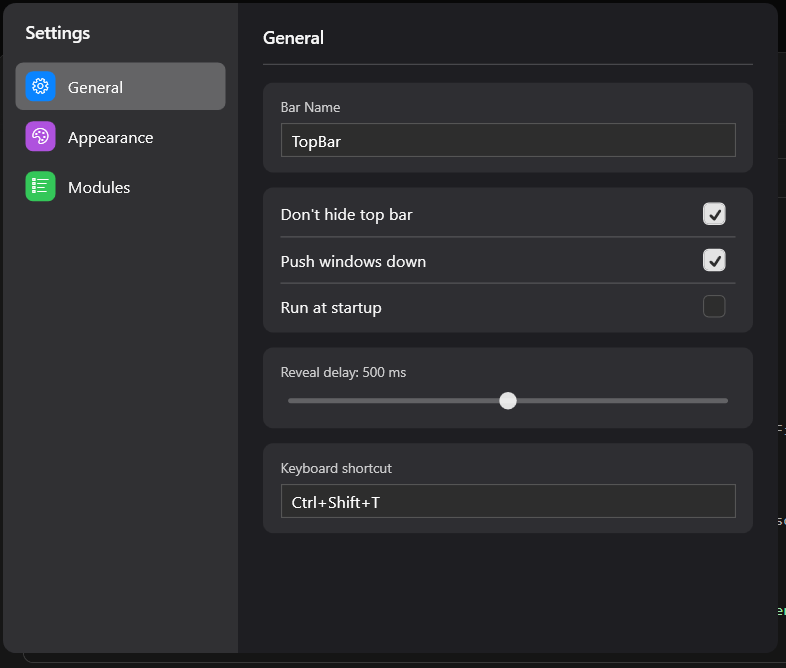

# Windows Topbar

A lightweight desktop utility that brings a macOS-style menu bar to Windows — a sleek top bar with live system stats, a Control Center, per-app menus, and more.



## Features

- macOS-style auto-hiding top bar (reveals when the cursor hits the top edge)
- Per-app **File / Edit / View** menus for the foreground window
- Live system stats: **CPU, Memory, Disk, GPU**
- **Control Center** — Wi-Fi, Bluetooth, Airplane mode, Do Not Disturb, brightness, volume, media
- Quick panels: Wi-Fi, Bluetooth, Brightness, Sound, Calendar, System Tray, Spotlight
- Apple-style menu (About, System Settings, sleep / restart / shut down / lock / log out)
- Mac-style dropdown chrome with a unified, configurable settings window
- Toggle and drag-to-reorder right-side items; custom bar colour and behaviour
- Runs **without administrator rights**

## Requirements

- Windows 10 build 17763 (1809) or newer, 64-bit
- [.NET 8 SDK](https://dotnet.microsoft.com/download/dotnet/8.0) to build from source

## Building from source

```powershell
git clone https://github.com/ThatAerospaceandTechGuy/Windows-Topbar.git
cd Windows-Topbar
dotnet build -c Release
```

The executable is produced at:

```
bin\Release\net8.0-windows10.0.17763.0\TopBar.exe
```

## Running

```powershell
.\bin\Release\net8.0-windows10.0.17763.0\TopBar.exe
```

Move the cursor to the very top edge of the screen to reveal the bar (or enable **Don't hide top bar** in Settings). Open **Settings** from the Apple menu in the top-left corner to configure modules, colours, and behaviour.

## Configuration

Settings are saved to `topbar-config.json` next to the executable.

## License

This project is **source-available** under the [TopBar Source License](LICENSE) — you may view, compile, and modify the source for personal use, but **redistribution of the software or source code is not permitted**. See [LICENSE](LICENSE) for the full terms.


